<!-- markdownlint-disable MD033 MD041 -->
<p align="center">
  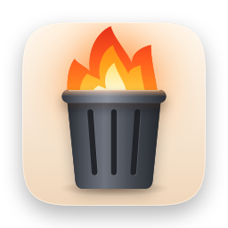
</p>

<h1 align="center">Burndown</h1>

<p align="center">
  Your Downloads folder, on a timer. A macOS menu bar app that gives every new
  download a lifetime, then moves it to the Trash when the time is up.
</p>

<p align="center">
  
  
  <a href="LICENSE"></a>
</p>

<p align="center">
  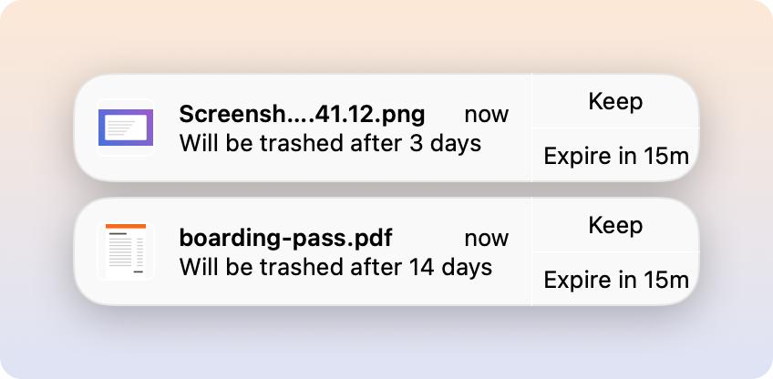
</p>

When a file lands in `~/Downloads`, Burndown shows a small toast in the
corner of the screen: **boarding-pass.pdf - Will be trashed after 14 days**,
with **Keep** and **Expire in 15m** buttons. Ignore it and the file goes to
the Trash in 14 days. Click **Keep** (or double-tap Shift) and it stays. It
can do the same for macOS screenshots, wherever you save them.

It is a native Swift app (SwiftUI and AppKit, no dependencies), event-driven
rather than polling, and it makes no network connections.

## Features

- **Watches `~/Downloads`** for new files from any source: browsers, AirDrop,
  Mail, `curl`. In-progress downloads (`.crdownload`, `.part` and similar) and
  dotfiles are skipped, and it waits for a file's size to settle before it
  counts it. A new folder counts as one item.
- **A toast for each new file** that looks like a macOS notification, showing
  the file's preview (images and PDFs) or icon, with **Keep** and a second
  button. You can drag the file straight out of the toast. Toasts stack in the
  top right, pause their auto-dismiss while you hover, and close with the
  `x` that appears on hover.
- **A lifetime and action for each source.** Downloads default to 14 days,
  then Trash. Pick anything from an hour to never, and **Trash** (recoverable)
  or **Wipe** (permanent delete, skipping the Trash).
- **Optional screenshot tracking** (off by default), for screenshots saved
  anywhere. The toast can appear the instant the screenshot thumbnail does,
  about 5 seconds before macOS writes the file, and swaps in the real preview
  when it arrives. See [Screenshots](#screenshots-and-the-early-toast).
- **Ordered rules**: ignore files, or give them their own lifetime and action,
  by kind, extension, name pattern, size or the site they were downloaded
  from. First match wins. **Preview matches** shows which files in Downloads
  a rule would apply to, without changing anything.
- **Activity log** of everything that expired, with **Put back** for files
  that went to the Trash.
- **Pause** stops tracking and expiry; the menu bar icon changes so you can
  see it is paused.
- **Double-tap Shift** while a toast is showing to keep the newest file,
  without reaching for the mouse. It can be turned off in Settings > General.
- **Customisable toast**: auto-dismiss time, button labels, and a second
  button that can be Expire in N minutes (the default, 15), Expire now,
  Snooze (by a number of days) or Reveal.
- **Launch at login**, registered automatically the first time it runs from
  `/Applications`, and easy to turn off.

## Screenshots

The menu bar popover: pause, the default lifetime and action for downloads
and screenshots, tracked files (each with Keep, Expire now and Reveal in
Finder) and recent activity.

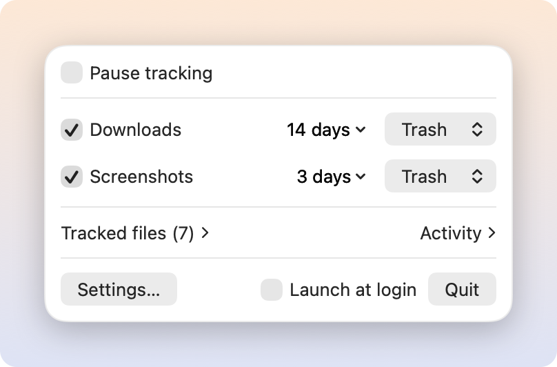

Rules run top to bottom and the first enabled match wins. This one wipes
videos over 500 MB three days after they arrive. The grey values are
placeholders, not part of the rule.

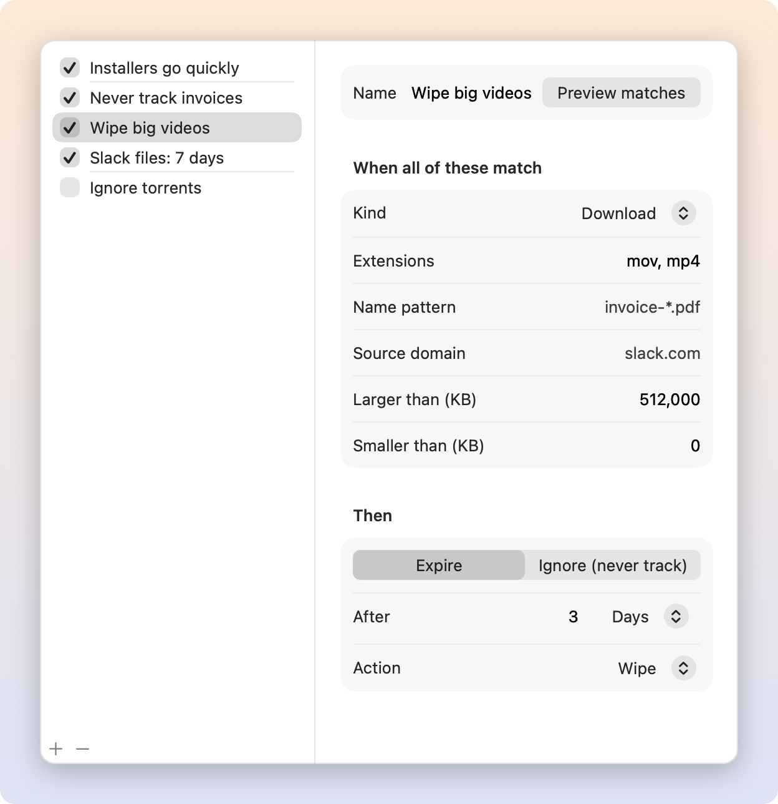

Screenshot tracking, with the option to show the toast as soon as the
thumbnail appears.

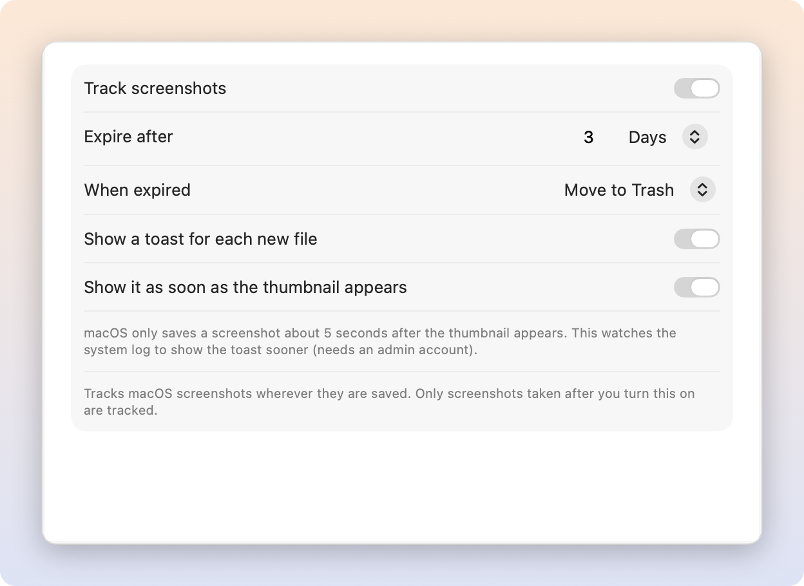

<details>
<summary>More: menu dropdowns, General, Downloads and Activity tabs, icons</summary>

Tracked files dropdown: a preview for images and PDFs, otherwise the Finder
icon, and Keep, Expire now and Reveal in Finder as buttons on each row.

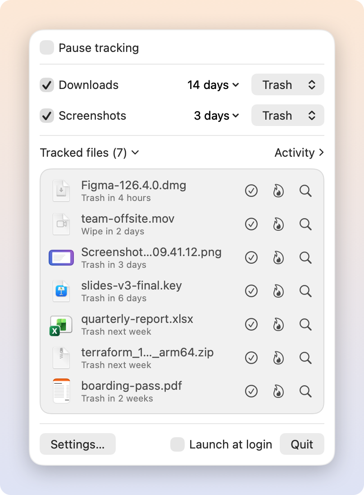

Activity dropdown: what expired, with a button to restore anything that went
to the Trash.

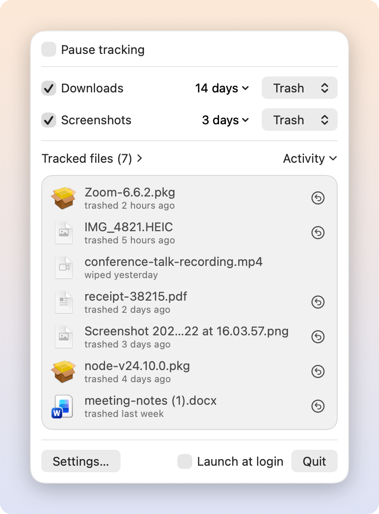

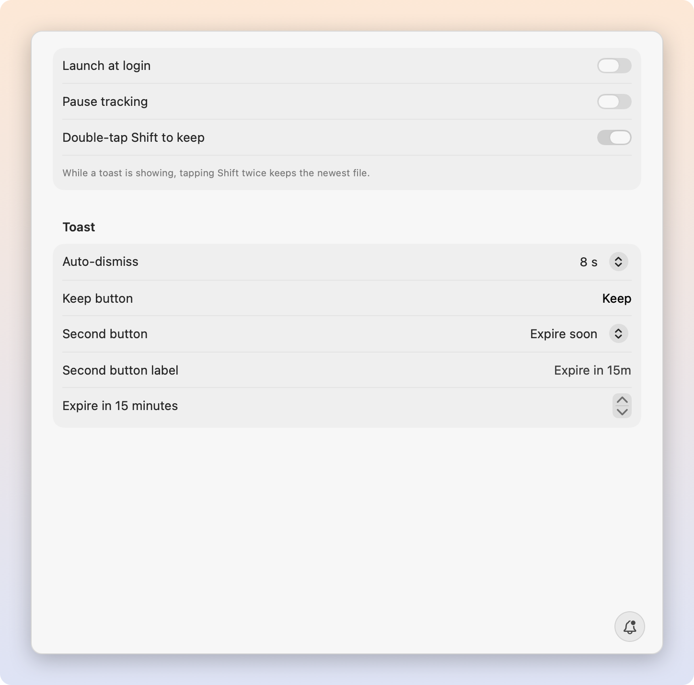

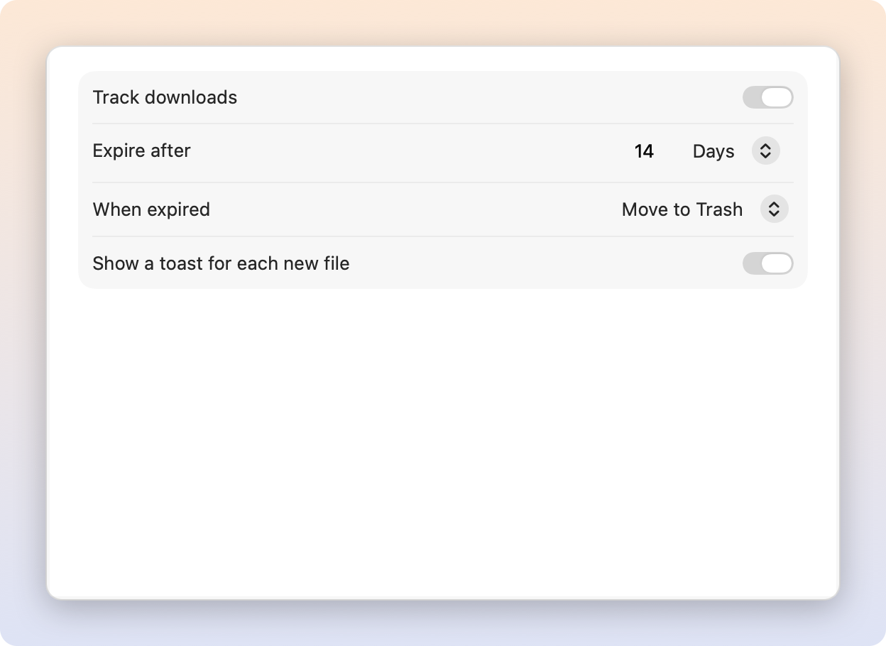

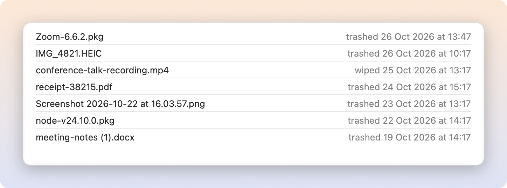

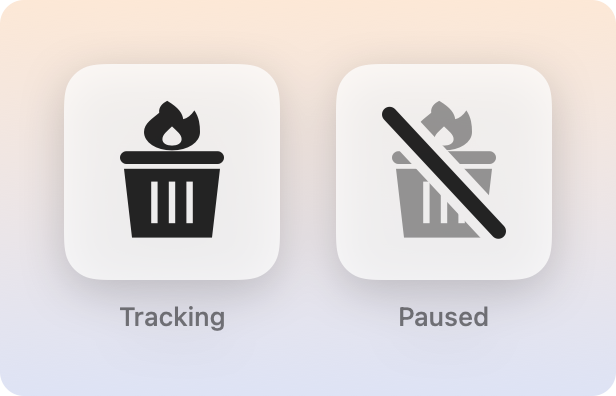

</details>

These images are rendered by the app itself from its real views, with demo
data, by `make docs-images`. macOS Liquid Glass does not render offscreen, so
the toast and menu are drawn on plain cards, the Settings tab bar is left
out, and switches show their inactive-window colour.

## Install

There are no release binaries yet, so build from source. You need macOS 26
and the Swift 6.2 toolchain (Xcode 26, or its Command Line Tools).

```sh
git clone https://github.com/aioue/burndown.git
cd burndown
make install
open /Applications/Burndown.app
```

`make install` builds a release binary, wraps it in an app bundle, signs it
ad hoc and copies it to `/Applications`, replacing any copy already there
(quit Burndown first when you update). Burndown lives in the menu bar only;
it has no Dock icon.

To try it without installing, `make run` builds and opens
`build/Burndown.app` instead.

## Permissions

| What              | When                         | Why                      |
| ----------------- | ---------------------------- | ------------------------ |
| Downloads folder  | Launch                       | To see and remove files  |
| Screenshot folder | Launch, if screenshots on    | To see screenshots there |
| Admin account     | Early screenshot toast       | `log stream` needs one   |
| Login item        | First run from /Applications | Launch at login          |

- **Folders**: Burndown asks for folder access when it starts, so the macOS
  prompts all appear at launch, not later when you open a menu. It touches
  Downloads, your screenshot folder (Desktop by default) if screenshot
  tracking is on, and any folder that already holds a tracked file. Without
  Downloads access nothing is tracked. Screenshots are found with Spotlight,
  which hides results from protected folders such as Desktop and Documents
  until the app has been given access.
- **Admin account**: for the early screenshot toast, Burndown runs
  `/usr/bin/log stream` as a child process to catch the moment a screenshot
  is taken, and macOS only lets admin accounts stream the system log. On a
  standard account the toast appears when the file is written instead. You
  can turn the early toast off in Settings > Screenshots.
- **Login item**: the first time it runs from `/Applications`, Burndown adds
  itself as a login item, once. Turn it off from the menu or Settings >
  General and it stays off. It is also listed in System Settings > General >
  Login Items & Extensions.

No notification permission is needed: toasts are Burndown's own windows,
not system notifications.

## How it works

### Keep

**Keep** adds a Finder tag called `Keep` to the file and stops tracking it.
A file with that tag is never tracked or removed, so you can also protect a
file yourself by adding the tag in Finder. Removing the tag later does not
start tracking the file again.

### Expiry is careful

When a file's time is up, Burndown checks it again before acting, and leaves
it alone (it just stops tracking it) if:

- the file no longer exists
- the file has the `Keep` tag
- a download has been moved out of `~/Downloads` (you have filed it)

Otherwise it does what the rule or default says:

- **Trash** moves the file to the Trash. It is recoverable from Finder, or
  with **Put back** in the menu's Activity list, which returns it to where it
  was (picking a free name if that one is taken) and tags it `Keep`.
- **Wipe** deletes the file permanently, skipping the Trash. **Expire now**
  asks for confirmation before wiping.

Screenshots are tracked wherever they are, even after you move them, so tag
a screenshot `Keep` if you want to hold on to it.

Only files that arrive while Burndown is running are tracked. Files already
in Downloads when it starts are left alone, and so are files that arrive
while it is paused. If the Mac was asleep or Burndown was not running when a
file came due, it is handled on wake or at the next launch. If a file cannot
be removed, Burndown tries again an hour later.

### Rules

Rules live in Settings > Rules. Each rule has a set of conditions, all of
which must match:

- **Kind**: any, download or screenshot
- **Extensions**: for example `dmg, pkg`
- **Name pattern**: a shell-style glob such as `invoice-*.pdf`, not case
  sensitive
- **Source domain**: the site a download came from, read from the
  "Where from" information macOS stores with downloaded files. `slack.com`
  also matches `files.slack.com`.
- **Larger than** / **smaller than**, in KB

Then the rule either **ignores** the file (it is never tracked) or **expires**
it after its own lifetime with Trash or Wipe. Rules run top to bottom, drag
to reorder, and the first enabled match wins. Files that match no rule use
the Downloads or Screenshots default. Two disabled example rules are
included.

A file's lifetime is fixed when it arrives, so editing a rule or a default
affects new files, not ones already tracked.

### Screenshots and the early toast

Screenshot tracking is off by default. Once on, it uses a live Spotlight
query for screen captures, so it finds screenshots wherever they are saved.
Only screenshots taken after you turn it on are tracked.

macOS writes a screenshot to disk only when its floating thumbnail goes away,
about 5 seconds after the capture. With **Show it as soon as the thumbnail
appears** on, Burndown watches the system log for the capture event and shows
the toast straight away with a camera placeholder, then swaps in the real
preview when the file lands. Keep or the second button pressed before then
is applied as soon as the file exists.

## Privacy

Burndown makes no network connections: there is no networking code, no
analytics and no update check. What it knows stays in one local JSON file.
The only other processes it starts are `/usr/bin/log` (for the early
screenshot toast) and `/usr/bin/pkill` (to clear out a `log` process left
over from a previous run).

## Where state lives

- `~/Library/Application Support/Burndown/state.json`: settings, rules,
  tracked files and the Activity log (the last 200 entries)
- A `didOfferLoginItem` flag in the `com.aioue.burndown` user defaults, so
  the login item is only added once

To uninstall, turn off **Launch at login**, quit Burndown, then delete
`/Applications/Burndown.app` and `~/Library/Application Support/Burndown`.
`Keep` tags stay on the files you kept.

## Known limitations

- **Screenshot previews lag by about 5 seconds**, because macOS only writes
  the file when the floating thumbnail goes away. Turning the thumbnail off
  (Screenshot app > Options > Show Floating Thumbnail) makes files land at
  once, at the cost of the thumbnail's markup and drag features.
- **The early screenshot toast needs an admin account**, since it relies on
  `log stream`.
- **Ad hoc signing**: Burndown is signed ad hoc, not with a Developer ID, so
  macOS ties folder permissions to that exact build and every rebuild asks
  for Downloads (and screenshot folder) access again. A build downloaded or
  AirDropped to another Mac is not notarised, so Gatekeeper blocks it until
  it is allowed in System Settings > Privacy & Security.
- **Top level only**: files inside subfolders of Downloads are not tracked
  on their own; a new folder is one item.
- **Screenshot tracking needs Spotlight** to be indexing the folder they are
  saved in.

## Development

```sh
make test         # unit tests (Swift Testing) for the core logic
make run          # build, sign ad hoc and open build/Burndown.app
make icon         # redraw Resources/AppIcon.icns from Scripts/make-icon.swift
make docs-images  # re-render the README images into docs/images
make zip          # build/Burndown.zip of the app bundle
```

To watch expiry happen without waiting days,
`BURNDOWN_TIME_SCALE=3600 build/Burndown.app/Contents/MacOS/Burndown` makes
each hour of lifetime pass in a second.

`make docs-images` runs the release binary with `--render-docs docs/images`.
It points the app at a throwaway home folder, seeds demo files and state
there, draws each view offscreen and exits, so it never touches your real
Downloads or state.

```text
Sources/BurndownCore/    Pure logic: rules, models, store, scheduler, expirer
Sources/Burndown/        The app: AppModel, watchers, menu, settings, toasts
Tests/BurndownCoreTests/ Unit tests for BurndownCore
Resources/               Info.plist and the app icon
Scripts/make-icon.swift  Draws the app icon
docs/images/             README images, made by make docs-images
```

There is no Xcode project; it is a plain Swift package with a Makefile.
Ideas for later are in [TODO.md](TODO.md).

## Licence

MIT. See [LICENSE](LICENSE).
